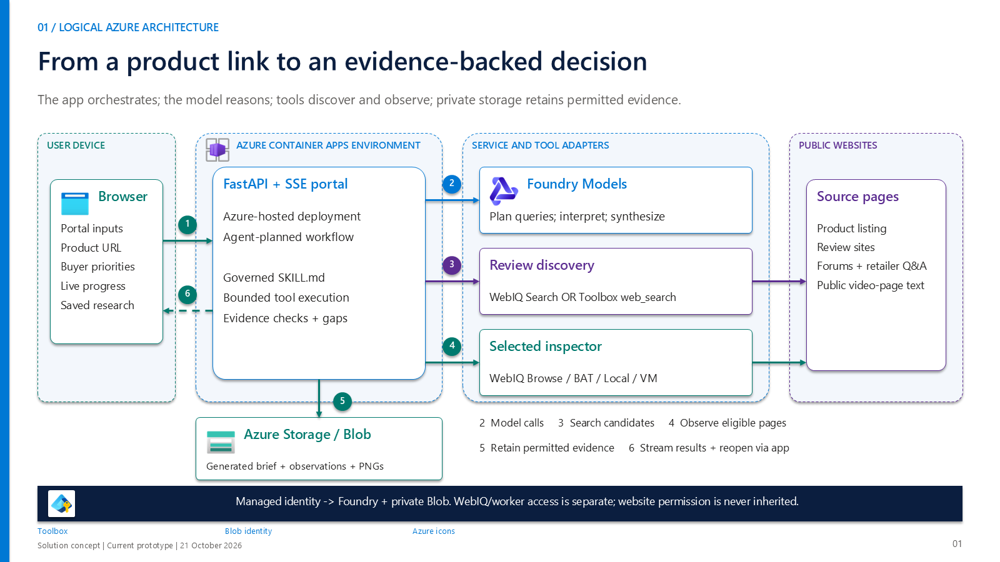
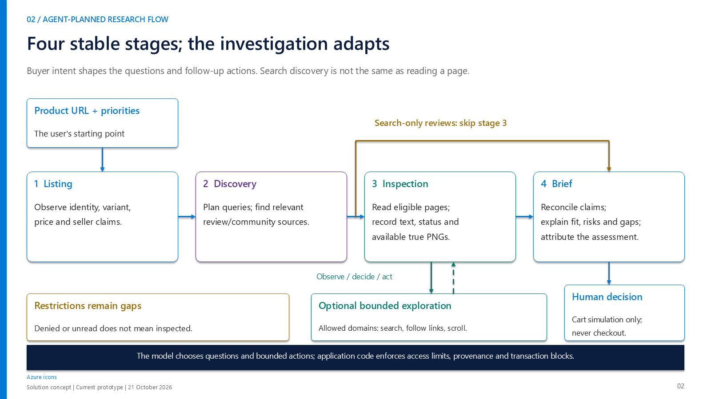
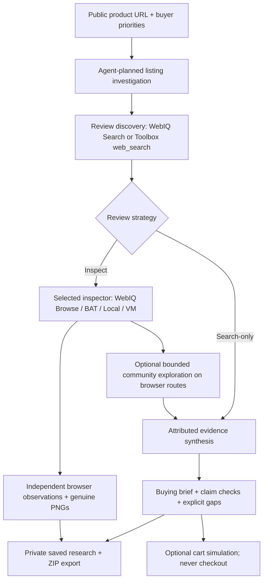
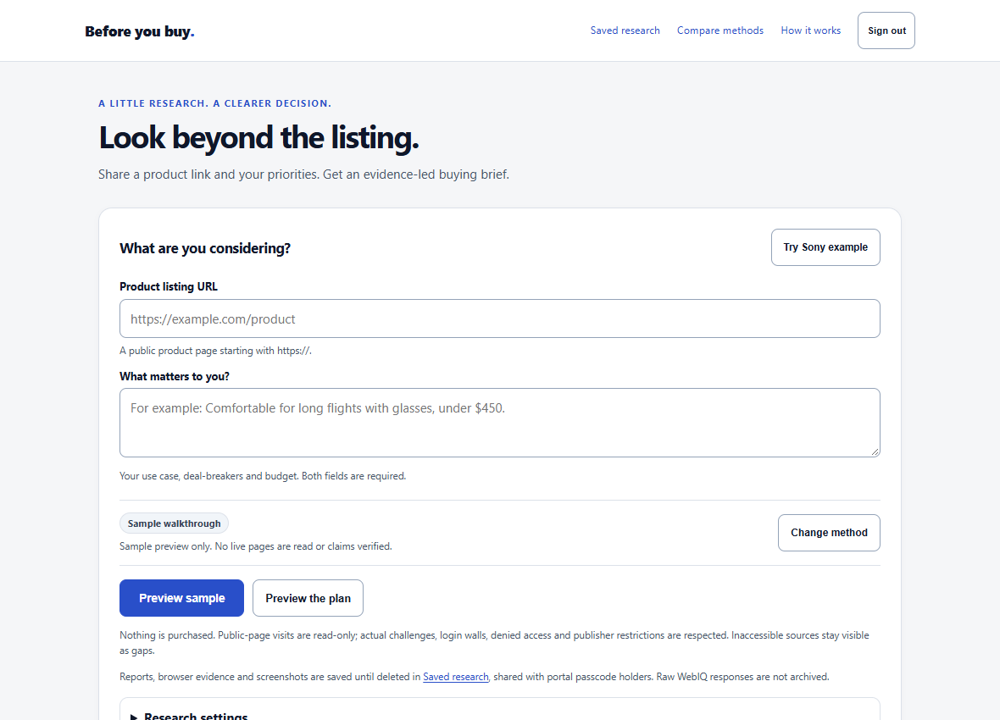
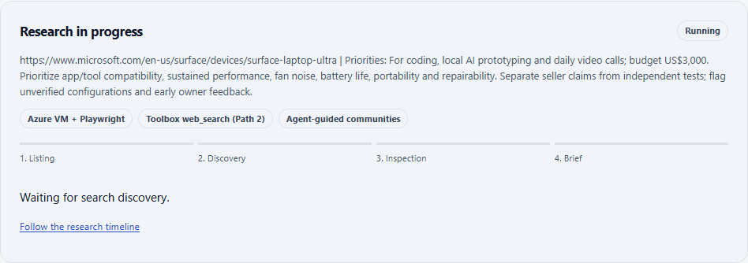

# WebIQ Demo: Product Review Research Agent

An agent-guided research portal that turns a **public product URL** and **buyer priorities** into an attributed buying brief. It separates seller claims, discovered search evidence, independently inspected pages and genuine browser screenshots rather than presenting them as equally verified facts.

**Status:** runnable research prototype, not a production shopping service. Offline walkthroughs work without Azure credentials. Live routes require your own resources, permissions and provider access. Cart approval is a simulation; purchasing and checkout are blocked.

The portal is called **Product Due-Diligence Assistant** in the implementation. This public repository is a clean source snapshot: it does not include development history, private research exports or the original publisher-page screenshots.

## Start here

| Goal | Guide |
|---|---|
| Run locally and enable individual research paths | [Setup and prerequisites](docs/SETUP.md) |
| Explain the architecture, research flow and evidence boundaries | [Solution concept diagrams](docs/Product-Review-Agent-Solution-Concept.pptx) |
| Host the portal, configure private storage and add a VM worker | [Deployment guide](docs/DEPLOYMENT.md) |
| Research a product, inspect the timeline and reopen saved evidence | [Portal user guide](docs/USER_GUIDE.md) |
| Review artifacts, validate changes and prepare a public release | [Publishing checklist](docs/PUBLISHING.md) |
| Install the local-browser bridge | [Browser extension instructions](browser_extension/README.md) |

These guides are product-neutral. Existing product-specific demo fixtures, benchmark snapshots and presentations are preserved as historical examples, not current buying recommendations.

## Quick start: no cloud credentials

Use **Python 3.12** and PowerShell from the repository root:

```powershell
git clone https://github.com/samsonlee0907/WebIQ-Demo-Product-Review-Research-Agent.git
Set-Location WebIQ-Demo-Product-Review-Research-Agent
python -m venv .venv
.\.venv\Scripts\python.exe -m pip install -r requirements.txt
Copy-Item .env.example .env
.\.venv\Scripts\python.exe -m uvicorn api.app.main:app --host 127.0.0.1 --port 8011 --workers 1 --no-proxy-headers --env-file .env
```

Open **http://127.0.0.1:8011**. Leave **Sample** selected, use the portal's example control or enter a public URL and priorities, and start research. A custom sample URL produces an explicitly unverified checklist, not fabricated product facts. Leave the WebIQ key empty for a fully offline walkthrough.

Do not overwrite an existing `.env`. The example contains no tenant, subscription, deployment or credential defaults. `--env-file` loads application settings; importing the app alone does not. Existing process variables take precedence.

## How it works

The [editable solution concept presentation](docs/Product-Review-Agent-Solution-Concept.pptx) explains the component architecture, four-stage flow, numbered request sequence, routing choices and evidence lifecycle. It is a short, product-neutral companion to the portal walkthrough. Reusable [architecture](docs/solution-concept/01-architecture.png) and [research-flow](docs/solution-concept/02-research-flow.png) images are included.





<details>
<summary>Text-based flow diagram</summary>



</details>

Four governed skills under `skills/` cover listing digestion, platform-agnostic review discovery, claim reconciliation and guarded cart simulation. The agent plans queries and, when enabled, bounded follow-up searches, observed-link navigation and scrolling. The four-stage research contract is stable; the investigation within it depends on the inputs and available evidence.

The supported portal runtime is **FastAPI + server-sent events + LangGraph/LangChain**, using Microsoft Foundry for live planning and synthesis. A separate Foundry-hosted-agent entrypoint is a reference scaffold, not a prerequisite or an already-deployed service.

## A tour of the portal

These are project-owned portal UI captures from a recorded walkthrough, not a live service or a new product recommendation. Example product names in the captures are historical; the workflow accepts other public product URLs.

**1. Start with a link and priorities.** Choose an offline sample or configure a live inspection method. Preview the plan before spending provider calls.



**2. Follow the investigation.** The live view identifies the selected inspector and discovery provider, then tracks listing, discovery, inspection and brief generation. The timeline distinguishes visited sources from access gaps.



**3. Revisit the result.** Saved research provides a follow-up link and an evidence export. Actual screenshot capture is available only on browser-backed paths; WebIQ Browse does not produce screenshots.


See the [portal user guide](docs/USER_GUIDE.md) for interpreting the brief, claim matrix, restrictions and saved evidence. The [five-slide architecture deck](docs/Product-Review-Agent-Solution-Concept.pptx) and [diagram previews](docs/solution-concept/03-request-sequence.png) provide the implementation walkthrough. Original publisher captures and the deployment-specific walkthrough package are deliberately not part of the public snapshot.

## Five live research paths

All live paths require a configured Foundry model and authorized runtime identity. Discovery uses a request-scoped WebIQ key when supplied, otherwise the configured toolbox's `web_search`.

| Path | Listing and review behavior | Additional requirement | Genuine screenshots |
|---|---|---|---|
| **WebIQ Browse** | Browse the listing and eligible discovered review pages through WebIQ | WebIQ access/key | No |
| **Azure BAT** | Use the configured Foundry browser tool and Playwright workspace | Toolbox browser connection, workspace access | Yes, when captured |
| **Local browser / Playwright** | Use the desktop Chrome/Edge extension bridge | Installed extension, connected portal tab | Yes, when captured |
| **Azure VM + Playwright** | Use the authenticated Windows worker's browser | Reachable, updated worker with a fresh heartbeat | Yes, when captured |
| **Search-only reviews** | Inspect the listing, discover reviews, then synthesize without opening review pages | A working listing inspector; WebIQ Browse is the default | Only if the listing inspector is a browser |

Search-only is a **review strategy**, not a fifth browser engine. API callers use a real `execution_mode` plus `inspect_review_pages=false`; there is no `execution_mode="search_only"`. A local/VM browser still needs the cloud model, but does not need a BAT workspace when using WebIQ discovery.

Optional community exploration is available only on BAT, Local and VM with review inspection enabled. An editable domain list limits the extra exploration, not initial general discovery. The controller has bounded actions, visits, searches, scrolls and elapsed time. Comments remain unverified assertions, not automatically authentic owner feedback.

## Evidence, safety and access

- **Attribution and uncertainty:** distinguish discovery snippets from visited pages; show restrictions, missing facts and partial outcomes. Search results can differ between runs, so timing comparisons do not establish answer quality.
- **Retention:** new generated reports with attribution, bounded independent browser observations and genuine PNGs remain in **Saved research until explicitly deleted**. Follow-up links and ZIP exports are supported. Local storage defaults to ignored `api\private_history\`; hosted operation requires authorized, network-accessible private Azure Blob storage.
- **WebIQ boundary:** raw search and Browse responses are workflow-only and are not archived. Generated internal work product with attribution has separate treatment under [WebIQ terms](https://www.microsoft.com/en-us/webiq/webiq-legal). Browser evidence is independently obtained and remains subject to publisher terms. Missing historical briefs are not reconstructed.
- **Access boundary:** the hosted passcode is a shared internal-demo gate. All signed-in holders can view and delete saved records. It is not per-user authentication or authorization.
- **Read-only operation:** actual access denials and sign-in requirements are respected. Two bounded same-session automatic verification rechecks are not interactive CAPTCHA solving. There is no proxy/inspector rotation to evade restrictions.
- **No transactions or media processing:** no real cart changes, checkout, payment, video downloads, transcription or video-understanding service.

Deleting a saved record removes its archived manifest and capture objects, not previously downloaded files or separate benchmark copies. An opaque, content-free tombstone prevents an old process from recreating the record. Storage and cloud compute incur charges until managed or removed.

## Repository map

| Location | Purpose |
|---|---|
| `api\app\` | Canonical portal HTML, API, orchestration, provider adapters, evidence store and access controls |
| `api\tests\` | Automated regression tests and loopback browser checks |
| `skills\` | Governed research instructions |
| `browser_extension\` | Desktop-browser observation bridge and shared discussion extractor |
| `scripts\` | Opt-in Azure bootstrap helpers, VM worker, benchmark and presentation tooling |
| `agents\hosted\` | Standalone hosted-agent reference, not the portal deployment |
| `docs\` | Setup/user/release guides and preserved historical artifacts |

There is no separate frontend build. `api\app\portal.html` is the served portal; `portal\index.html` is a legacy snapshot. Private captures, local credentials and saved history are not part of a source checkout or a default release image.

## Development

```powershell
.\.venv\Scripts\python.exe -m pytest api\tests -q
```

Optional browser checks require the running loopback portal and desktop Edge:

```powershell
.\.venv\Scripts\python.exe api\tests\check_portal_browser.py http://127.0.0.1:8011
.\.venv\Scripts\python.exe api\tests\check_evidence_archive_browser.py http://127.0.0.1:8011
```

Cloud calls are mocked in automated regression tests. Browser checks use explicitly labelled samples/synthetic fixtures, not paid live benchmarks. CI runs the regression suite without cloud credentials. Fresh cloud provisioning, provider quotas, site access and live answer quality require separate environment-specific acceptance checks.

## License and references

Repository code and documentation are available under the [MIT License](LICENSE). Provider services, dependencies, publisher content and third-party artifacts retain their own terms; MIT does not grant rights to redistribute captured website content.

The selected Microsoft Azure icons used in the concept diagrams retain Microsoft's [icon usage terms](docs/assets/azure-icons/NOTICE.txt), not MIT. Original SVGs and their source hashes are included for architecture/training/documentation use.

Implementation and setup references: [Foundry browser automation](https://learn.microsoft.com/en-us/azure/foundry/agents/how-to/tools/browser-automation), [Foundry toolboxes](https://learn.microsoft.com/en-us/azure/foundry/agents/how-to/tools/toolbox), [WebIQ Search](https://learn.microsoft.com/en-us/web-iq/reference/web-search), [WebIQ Browse](https://learn.microsoft.com/en-us/web-iq/reference/browse), [Azure Blob Python SDK](https://learn.microsoft.com/en-us/azure/storage/blobs/storage-quickstart-blobs-python), [Playwright](https://playwright.dev/python/docs/intro) and [Chrome extension match patterns](https://developer.chrome.com/docs/extensions/develop/concepts/match-patterns).
