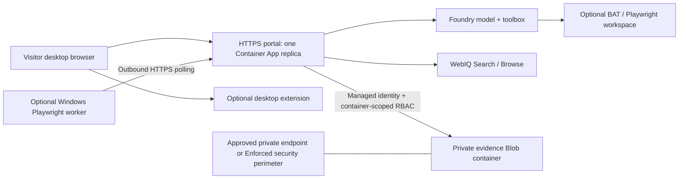

# Deployment guide

Deploy **your own** portal and dependencies. This repository contains no shared Azure account, deployed model, credentials or guaranteed service quota. The suggested sequence enables all five research paths; skip optional BAT or VM resources if those paths are not needed.

The helpers are opt-in **demo bootstrap tools**, not general production infrastructure management. Their plans can be inspected without creating resources. Review subscription, names, regions, permissions, network policy, installer versions and cost before using `--apply`. A fresh deployment in another tenant still requires its own acceptance checks.

## 1. Suggested topology



Keep **one Uvicorn worker and one application replica**. Active command queues, approval tickets and some operational state are process-local. Durable Blob storage does not make the remaining orchestration horizontally scalable.

## 2. Prepare resources and configuration

Prepare Foundry, a deployed model and the toolbox/browser connections described in [setup](SETUP.md). The portal does **not** require deploying `agents\hosted\pdd_hosted_agent.py`.

Create a dedicated application resource group and user-assigned managed identity. These Azure CLI examples are operator actions, not commands the running app executes. Replace every quoted placeholder:

```powershell
az account set --subscription "YOUR_SUBSCRIPTION_ID"
az group create --name "YOUR_APP_RESOURCE_GROUP" --location "YOUR_REGION"
az identity create --name "YOUR_IDENTITY_NAME" --resource-group "YOUR_APP_RESOURCE_GROUP" --location "YOUR_REGION"
```

Set these in your private `.env` in addition to Foundry settings:

| Setting | Guidance |
|---|---|
| `PDD_RESOURCE_GROUP` | Application resources; Foundry may use a different group in the same subscription |
| `PDD_AZURE_LOCATION` | A region supporting your selected app/storage/network services |
| `PDD_ACR_NAME` | Globally unique lowercase/alphanumeric registry name |
| `PDD_IDENTITY_NAME` | The identity created above |
| `PDD_CONTAINER_APP_NAME`, `PDD_CONTAINER_ENVIRONMENT_NAME` | Names for a new application/environment |
| `PDD_PASSCODE_FILE` | Optional private access-file path **outside this repository** |

Helpers read **process environment variables**, not `.env` automatically. The following wrapper loads `.env` through the installed `python-dotenv` CLI without replacing already-set process values:

```powershell
.\.venv\Scripts\python.exe -m dotenv -f .env run --no-override -- .\.venv\Scripts\python.exe scripts\deploy_container_app.py --help
```

Use that same prefix for the Python bootstrap commands below. Azure CLI commands do not automatically read `.env`; use their explicit arguments.

The helpers use the tenant/account-pinned local MSAL cache, not an interactive fallback, workload federation or service-principal secret. Sign in manually as described in setup and pin the intended user. For unattended organizational deployment, adapt the management credential to your approved CI identity rather than distributing a developer token cache.

## 3. Provision durable evidence storage first

The identity must already exist. Review the storage plan:

```powershell
.\.venv\Scripts\python.exe -m dotenv -f .env run --no-override -- .\.venv\Scripts\python.exe scripts\provision_evidence_storage.py --enforced-perimeter
```

If your organization permits the proposed Enforced network security perimeter and subscription-based managed-identity inbound rule, explicitly apply it:

```powershell
.\.venv\Scripts\python.exe -m dotenv -f .env run --no-override -- .\.venv\Scripts\python.exe scripts\provision_evidence_storage.py --apply --enforced-perimeter
```

The helper creates a dedicated zone-redundant encrypted storage account/container, disables anonymous access and shared-key authorization, and grants the configured identity container-scoped Blob Data Contributor. It configures `SecuredByPerimeter`, an Enforced association and an inbound subscription rule. RBAC remains a separate access check.

Copy the returned non-secret `account_url` into `PDD_EVIDENCE_BLOB_ACCOUNT_URL` in `.env`, and set `PDD_EVIDENCE_BLOB_CONTAINER=research-evidence`.

Without `--enforced-perimeter`, the helper leaves public network access **Disabled**. It does **not** create a private endpoint, VNet or DNS configuration. That mode is usable only after you supply a compliant private network path. A disabled account with no endpoint is not a working deployment.

Check the observed network setting and identity-based Blob write/read/delete **from the application's actual network**. An operator laptop can be denied even when the managed identity is permitted. Do not enable public IP allow-all rules or add policy-exemption tags as a workaround.

There is no automatic expiry, versioning or soft-delete recovery in this dedicated design. Retention is until explicit deletion. The encrypted redundant service is not a separate backup policy; define backup/recovery requirements before production use. See [storage perimeter guidance](https://learn.microsoft.com/en-us/azure/storage/common/storage-network-security-perimeter) and [Blob identity authorization](https://learn.microsoft.com/en-us/azure/storage/blobs/authorize-access-azure-active-directory).

## 4. Bootstrap a new portal

Inspect the plan, then explicitly apply it:

```powershell
.\.venv\Scripts\python.exe -m dotenv -f .env run --no-override -- .\.venv\Scripts\python.exe scripts\deploy_container_app.py
.\.venv\Scripts\python.exe -m dotenv -f .env run --no-override -- .\.venv\Scripts\python.exe scripts\deploy_container_app.py --apply
```

This assumes an existing resource group, configured Foundry project/model/toolbox, and reachable identity-authorized evidence storage. It creates/configures an identity, a standard RBAC registry, an ACR remote build, Foundry role assignments, an app environment and the HTTPS Container App. It passes the configured storage endpoint/container into the runtime. Model deployment, toolbox creation, BAT workspace permissions and organization-specific network integration are **not** performed by this helper.

The helper refuses to overwrite an existing Container App or delete a failed/wrong-region environment. It is a new-application bootstrap, not an application updater. Names should identify dedicated resources; do not point it at unrelated registries, identities or network infrastructure.

Access details are generated privately under the configured `PDD_PASSCODE_FILE` path; by default this is `~\.config\product-due-diligence\portal-access.txt` plus a companion JSON file. Do not commit, paste into issues, or distribute the signing secret. Protect the directory with appropriate local permissions. A corrupt access file fails explicitly instead of silently rotating credentials.

Default images exclude private benchmark receipts/captures even if they exist in the working directory. `--include-private-replay` is a deliberate opt-in for a **private** permitted-evidence image only; never use it for a public image or raw WebIQ Content.

For other deployment tooling, preserve this runtime contract:

| Setting/configuration | Required behavior |
|---|---|
| `PDD_HOSTED_MODE=true`, `PDD_REQUIRE_PASSCODE=true` | Hosted managed identity and shared demo gate |
| `FOUNDRY_MANAGED_IDENTITY_CLIENT_ID` | Client ID of the identity attached to the app |
| `FOUNDRY_PROJECT_ENDPOINT`, `FOUNDRY_MODEL_DEPLOYMENT`, `FOUNDRY_TOOLBOX_NAME` | Your live research resources |
| `PDD_EVIDENCE_BLOB_ACCOUNT_URL`, `PDD_EVIDENCE_BLOB_CONTAINER` | Reachable, authorized private durable storage |
| `PDD_PASSCODE_SHA256`, `PDD_SESSION_SIGNING_SECRET` | Secret-backed passcode digest and strong signing secret; the helper also supplies its worker-route passcode secret |
| `PDD_ALLOWED_HOSTS`, `PDD_ALLOWED_ORIGINS` | Actual hostname(s) and HTTPS origin(s), not wildcard trust |
| `PDD_TRUSTED_INGRESS_PROXY=aca` | Only behind the expected Container Apps ingress; do not use for arbitrary proxies |
| Process/scale | Port 8000, one Uvicorn worker, one replica, external HTTPS only |

Custom domains require corresponding allowed-host/origin configuration and extension match patterns. Other reverse proxies need an explicitly supported trust configuration; blindly trusting forwarded headers is not a substitute.

Authenticate in the portal and check `/api/health`, `/api/research-contract` and the worker status shown in settings. A healthy HTTP server does not prove model permissions, worker readiness, data-plane access or site accessibility.

## 5. Enable the VM path

### Manual worker installation on a managed Windows host

Use a dedicated host with a supported Chrome installation, Python 3.12, enough memory for a native browser and outbound HTTPS to the portal/research sites. Start with at least two vCPUs and 4 GB RAM; more memory may be necessary. Patch the OS/browser/runtime according to your organization's policy.

Place these two files together in a protected worker directory:

- `scripts\windows_playwright_worker.py`
- `browser_extension\community_snapshot.js`

Install the worker's dependencies:

```powershell
python -m pip install httpx playwright
```

It uses installed Chrome, so no Playwright-downloaded Chromium binary is required. If auto-detection fails, set `CHROME_EXECUTABLE_PATH` to the Chrome executable.

Provide `PDD_PORTAL_URL` with the actual portal HTTPS origin and `PDD_DEMO_PASSCODE` through a private service/task environment or protected configuration. Do not put the passcode in command-line arguments or Git. Then run:

```powershell
python C:\pdd-worker\windows_playwright_worker.py
```

Confirm **VM worker online** in the portal. Run the worker as an appropriately managed startup task/service if it must survive logoff/reboots. No public RDP port or desktop extension is necessary for the headless worker. Do not expose CDP to the internet.

### Optional new-VM bootstrap helper

Set `PDD_PORTAL_URL`, `PDD_VM_NAME`, `PDD_VM_LOCATION` and `PDD_VM_SIZE`. Check regional SKU availability and cost; the helper does not silently select larger alternatives. Review its pinned bootstrap installers before applying it.

```powershell
.\.venv\Scripts\python.exe -m dotenv -f .env run --no-override -- .\.venv\Scripts\python.exe scripts\provision_windows_vm_worker.py
.\.venv\Scripts\python.exe -m dotenv -f .env run --no-override -- .\.venv\Scripts\python.exe scripts\provision_windows_vm_worker.py --apply
```

It requires the existing portal's private access JSON and refuses to overwrite an existing VM. It creates dedicated network resources with no public inbound ports, installs the worker/extractor, restricts the worker directory and registers its startup task. The worker passcode travels as a protected Managed Run Command parameter, not an embedded source-script value. VM admin credentials stay in a separate private local file.

For an existing VM, use the manual installation/update procedure rather than this bootstrap. Update the worker and adjacent extractor together, restart only that worker, and confirm a new heartbeat. Updating the portal image alone does not update the VM or desktop extension.

VM compute, disks and network resources incur charges. Configure your own explicit operating schedule; the repository does not automatically keep hosts running or shut them down.

## 6. Upgrade and operate

Build a new image tag/digest through your approved build process, then update **only the image** of the existing app. For example, after replacing placeholders:

```powershell
az containerapp update --name "YOUR_APP_NAME" --resource-group "YOUR_APP_RESOURCE_GROUP" --image "YOUR_REGISTRY.azurecr.io/pdd-portal:YOUR_NEW_TAG"
```

Preserve identity, secrets, origins, storage settings and one-replica scaling. See [managed-identity image pulls](https://learn.microsoft.com/en-us/azure/container-apps/managed-identity-image-pull). Do not rerun the bootstrap against a live app.

Before retiring the previous revision, verify sign-in, the configured paths, saved history and exported PNG hashes. Interrupted in-flight workflows can have a partial checkpoint; missing memory-only operational state is not reconstructed.

Passcode rotation must update the worker credential and replace the session-signing secret to invalidate sessions. Store secrets using your deployment platform's secret controls, not command history. The shared passcode gate is not suitable for confidential multi-user deployments; add real identity, authorization, audit, rate limits and operational controls before such use.

## 7. Troubleshooting

| Symptom | Check |
|---|---|
| Offline works, live fails | Correct project endpoint/deployment, account pin, roles, model capabilities and quota |
| WebIQ Browse asks for a key | Its Browse API does not use Toolbox `web_search` as a hidden replacement |
| Keyless discovery fails | Toolbox exposes `web_search`; correct default version and caller authorization |
| BAT session creation fails | Tool name, project connection, workspace permissions, supported region and remote connectivity |
| Local bridge not connected | Desktop browser, exact portal match pattern, extension reload and portal refresh |
| VM is running but offline | Worker process/task, correct portal URL/passcode, adjacent extractor, outbound HTTPS and fresh heartbeat |
| Research is rejected before starting | Durable storage first checkpoint or concurrency admission failed; inspect the explicit message |
| Storage returns 403 | Blob data role **and** firewall/perimeter/private endpoint; test from the app network |
| Comments remain missing | Dynamic loading/read-only request restrictions; do not interpret absence as no community discussion |
| Report has no old screenshots/brief | Source/public images do not contain private captures; expired grounding is not reconstructed |

Official references: [Foundry toolbox setup](https://learn.microsoft.com/en-us/azure/foundry/agents/how-to/tools/toolbox), [BAT](https://learn.microsoft.com/en-us/azure/foundry/agents/how-to/tools/browser-automation), [Managed Run Commands](https://learn.microsoft.com/en-us/rest/api/compute/virtual-machine-run-commands/create-or-update?view=rest-compute-2024-03-01) and [Container Apps image updates](https://learn.microsoft.com/en-us/azure/container-apps/containers).
